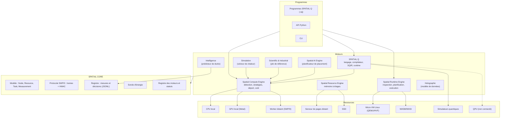

# 05 — Architecture : SPATIAL CORE et les moteurs

État du code : prototype de recherche. Le statut de chaque moteur est déclaré dans `spatial/core/registry.py` et un test vérifie qu'aucun statut n'est donné sans preuve associée.

## 1. Vue d'ensemble



Trait plein : implémenté et testé. Pointillé : interface présente, exécution refusée faute d'accès.

## 2. SPATIAL CORE

| Composant | Fichier | Rôle |
|---|---|---|
| Modèle de données | `spatial/core/model.py` | `Node` expose des `Resource` typées (`cpu`, `gpu`, `npu`, `ram`, `far_memory`, `storage`, `network`, `qpu`, `qsim`). `Task` nomme une charge autorisée et ses besoins. `Measurement` est le résultat de toute exécution, échecs compris. |
| Protocole SWP/0 | `spatial/core/protocol.py` | RPC sur TCP : en-tête JSON + blob binaire, authentification HMAC-SHA256 par défi. |
| Registre | `spatial/core/ledger.py` | Journal JSONL en ajout seul des mesures et des décisions avec leur raison. |
| Énergie | `spatial/core/energy.py` | Lecture de la jauge batterie ; signale quand la lecture est figée. |
| Statuts | `spatial/core/registry.py` | Statut, preuve et « non fait » de chaque moteur. |

Principe de typage : la mémoire compressée, distante ou sur disque est de type `far_memory`, jamais `ram`. Un test l'impose.

## 3. Interfaces entre moteurs

| De | Vers | Interface |
|---|---|---|
| SPATIAL Q (runtime) | Compute Engine | `workloads.run(nom, **params)` en local ; `{"op":"run","workload":…}` vers un worker |
| SPATIAL Q (runtime) | Backends quantiques | `Backend.sample(circuit, shots, seed)`, `Backend.expectation(circuit, pauli)` ; `BackendUnavailable` si l'exécution réelle est impossible |
| Compute Engine | Worker | SWP/0, opérations `ping`, `run` |
| Resource Engine | Étage lointain | Protocole `FarBackend` : `put`, `get`, `get_many`, `delete` (fichier SSD ou serveur de pages SWP/0) |
| Runtime Engine | Exécuteurs | `plan(artefact) → [Route]`, `execute(chemin, args, route)` |
| Moteurs scientifique, simulation, IA | Compute Engine | `Measure` (durée, CPU, RSS) et `ComputeScheduler.compare()` |
| Intelligence | Registre | `PowerLawPredictor.from_ledger(rows)` |

## 4. API (prototype, Python)

```python
# Compute
node = detect_node(); limitations(node); snapshot()
sched = ComputeScheduler(node, ledger, worker_client)
rows = sched.compare("exp", {"n": 4000, "iters": 300}, sched.mandel_strategies())
best = sched.choose(rows, objective="time")          # "time" | "cpu" | "energy"

# Mémoire à étages
store = TieredStore(hot_bytes, compressed_bytes, far=RemoteBackend(client), codec_name="lz4",
                    prefetch=16, keep_far_copy=True)
store.put(k, page); store.get(k); store.stats()

# Runtime
art = inspect("app.exe"); routes = plan(art); result = execute("app.elf", ["arg"])

# SPATIAL Q
env, rt = run_source(source, worker_client=None, seed=1); rt.trace
circuit, info = compile_kernel(program.kernels["k"], [args]); circuit.to_qasm3(); circuit.to_json()
```

Ligne de commande : `python -m spatial.q {run|check|qasm|ir} fichier.sq`.

## 5. Protocole de communication SWP/0

```
connexion      serveur → client : nonce (16 octets)
               client → serveur : HMAC-SHA256(jeton, nonce)
trame          u32 longueur_entête | u32 longueur_blob | entête JSON | blob
réponse        {"ok": true, …} ou {"ok": false, "error": "Type: message"}
```

Limites connues : pas de chiffrement du canal (à faire passer dans TLS ou WireGuard avant tout usage hors boucle locale), pas de protection contre le rejeu au-delà du défi initial, une requête à la fois par connexion.

## 6. Modèles de données

| Objet | Champs essentiels |
|---|---|
| `Resource` | `kind`, `name`, `capacity`, `unit`, `available`, `attrs` |
| `Measurement` | `engine`, `experiment`, `strategy`, `ok`, `wall_s`, `cpu_s`, `peak_rss_bytes`, `energy_j` (ou `None`), `cost_usd`, `metrics`, `notes` |
| `Artifact` | `format` (macho, elf, pe, wasm, script), `os`, `arch` |
| `Route` | `name`, `feasible`, `reason`, `expected_overhead`, `isolation` |
| `Circuit` (SQIR) | `n_qubits`, `n_cbits`, `ops[Op(name, qubits, params, cbit, cond)]`, `estimate()` |
| `ResourceEstimate` | qubits, portes, portes à 2 qubits, profondeur, mesures intermédiaires, octets du vecteur d'état |

## 7. Sécurité et permissions

| Mécanisme | Implémenté |
|---|---|
| Serveurs liés à `127.0.0.1` ; lier une autre adresse lève `PermissionError` sans `allow_remote=True` explicite | Oui, testé |
| Authentification HMAC par jeton aléatoire de 32 octets, fichier en mode 600 | Oui, testé (mauvais jeton rejeté) |
| Aucune exécution de code transmis : le worker n'exécute que des charges nommées dans une liste blanche | Oui, testé |
| Micro-VM sans réseau, sans disque, sans dossier partagé ; RAM plafonnée | Oui |
| Quota de mémoire sur le serveur de pages | Oui |
| Chiffrement des pages avant envoi, chiffrement du canal | **Non** |
| Permissions par utilisateur ou par locataire, quotas CPU, audit signé | **Non** — conception : jetons à portée (`run:<charge>`, `mem:<quota>`), journal signé |
| Bac à sable pour charges arbitraires de tiers | **Non** — passerait par la micro-VM ou WASI |

## 8. Orchestration et environnements d'exécution

Boucle commune : **décrire → estimer → mesurer → choisir → consigner**.

1. La tâche déclare ses besoins ; le moteur énumère les stratégies réalisables sur le nœud détecté.
2. Chaque stratégie est exécutée et mesurée ; son résultat doit égaler la référence.
3. Le choix se fait sur un objectif (durée, CPU, énergie) et est consigné avec les candidats.
4. Le prédicteur peut, à partir du registre, estimer la durée avant exécution.

Environnements : processus hôte ; pool de processus ; worker SWP/0 ; micro-VM Linux (HVF ou TCG) ; WASM/WASI ; environnement Python isolé ; simulateurs quantiques (NumPy interne, Qiskit Aer).

## 9. Passage à l'échelle (conception, non implémenté)

| Besoin | Piste |
|---|---|
| Plusieurs nœuds | Annuaire de nœuds et battements de cœur au-dessus de SWP/0 ; placement par le planificateur existant étendu à N workers |
| Débit du protocole | Remplacer l'entête JSON par un format binaire, multiplexer les requêtes, QUIC |
| Mémoire lointaine sérieuse | Sous Linux : `userfaultfd`, zswap, RDMA ; le prototype en Python sert à valider les politiques, pas les performances |
| Tolérance aux pannes | Réplication ou codes d'effacement des pages lointaines ; ré-exécution des tâches idempotentes |
| Multi-locataire | Jetons à portée, quotas, micro-VM par locataire |
| Noyau de performance | Réécriture des chemins chauds en Rust ou C++ ; Python reste la couche de décision |

## 10. Organisation du code

```
spatial/core         modèle, protocole, registre, énergie, statuts
spatial/compute      detect, monitor, workloads, worker, scheduler, cost
spatial/memory       tiered (étages), pageserver, fararray
spatial/runtime      inspect, planner, microvm, toolchain, envs
spatial/q            lexer, parser, ir, compiler, sim, backends, runtime
spatial/ai           placement (planificateur analytique)
spatial/scientific   jobs (Monte-Carlo validé par formule fermée)
spatial/simulation   heat (diffusion 2D)
spatial/intelligence predictor (loi de puissance)
spatial/holographic  model (grille de voxels, spécification champ lumineux)
benchmarks/          bench_*.py, src/, results/*.json
tests/               pytest
examples/            programmes .sq
```
